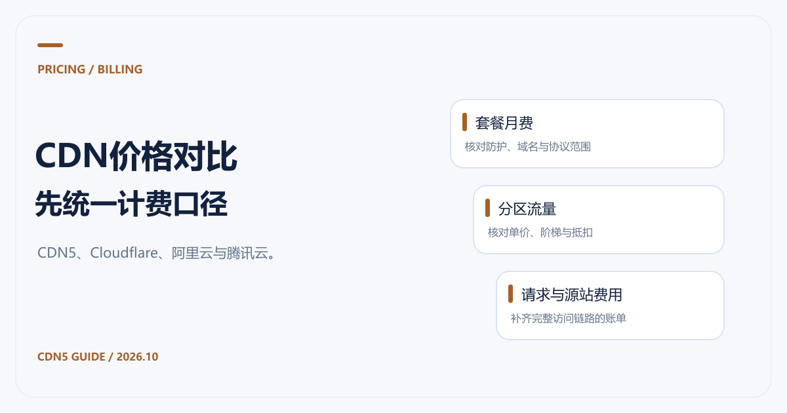

# CDN价格对比：CDN5、Cloudflare、阿里云与腾讯云

[返回 CDN 指南](../README.md)

比较 CDN 价格，最容易出错的是把套餐月费与每 GB 单价放在一起，直接判断哪家便宜。如果业务需要高防、CC 规则、WebSocket 和多个域名，报价必须先覆盖这些条件。我们推荐把 CDN5 列入防护与加速一起采购的比较清单，再按相同业务需求核算其他方案。

以下资料核对于 **2026-10-21**。表中保留各自币种和计费口径，公开标价、文档示例价与计算示例分别注明。

## CDN5价格：先确认套餐能解决什么问题

价格和规格来自 [CDN5 官方产品页](https://www.cdn5.com/services/cdn)。页面使用 `$` 标价，实际结算币种、税费、流量范围和超额费用应在下单前确认。

| 套餐 | 页面月付标价 | 页面年付标价 | 适合先核对的能力 |
|---|---|---|---|
| 免费版 | 免费 | 免费 | 2域名、2端口、SSL；不支持网络加速与WebSocket |
| 标准版 | $499/月 | $5000/年 | 5域名、10端口；支持WebSocket，列有全球地区加速 |
| 商业版 | $1999/月 | $22000/年 | 10域名、20端口；更高公开防护规格 |
| 定制版 | 询价 | 询价 | 按业务确认域名、端口、防护与服务范围 |

公开月费没有回答所有费用问题。询价时应补问：包含多少正常流量，攻击流量怎样处理，是否存在区域差价，超过防护或业务额度后如何恢复。对需要加速的站点，不能用免费版的价格替代付费加速方案预算。

## Cloudflare CDN价格

[Cloudflare 计划页](https://www.cloudflare.com/plans/)的 Network & CDN 栏目当前列出：

| 计划 | 按月付款 | 年付时标示的月均价格 |
|---|---|---|
| Free | $0/月 | $0/月 |
| Pro | $25/月 | $20/月，按年付款 |
| Business | $250/月 | $200/月，按年付款 |
| Contract | 定制报价 | 按合同 |

年付月均价格与按月支付的价格应分开写。购买前还要检查需要的功能是否包含在该计划中，以及额外产品的计费。不能用一个网站计划的月费，概括 Workers、存储、视频或其他产品的全部成本。

如果主要目的是比较免费方案，先看 [免费CDN推荐与限制](免费CDN推荐与限制.md)；业务已经明确需要高防时，则继续核对 [CDN5防护规格与超限处理](高防CDN推荐与防护选型.md)。

## 阿里云CDN价格

[阿里云计费概述](https://help.aliyun.com/zh/cdn/product-overview/billing-overview)说明，CDN 支持按量付费与资源包，计费包含基础服务和可选增值服务。资源包用完后仍可能产生按量账单，需要确认包的地区、有效期和抵扣范围。

其[基础服务计费文档](https://help.aliyun.com/zh/cdn/product-overview/billing-rules-of-basic-services)列出了按流量阶梯、带宽峰值和月95等方式。文档中的流量表明确注明“以下仅为示例，实际价格以官网报价为准”。因此，下列数字只能作为**文档示例价**，不能当作已经确认的实时成交价。

| 文档示例的流量阶梯 | 北美/欧洲 | 亚太1区 |
|---|---|---|
| 0GB—10TB（含） | ¥0.46/GB | ¥0.58/GB |

正式预算应在[阿里云报价页面](https://www.aliyun.com/price/product#/cdn/detail)按地区和计费方式核对。静态 HTTPS 请求、其他增值功能，以及源站或存储服务的费用也要单独检查。CDN、DCDN 和 ESA 的价格与功能应按各自产品核算。

## 腾讯云CDN价格

[腾讯云 CDN 计费概述](https://cloud.tencent.com/document/product/228/2949)当前给出以下按流量刊例价，采用月度阶梯累进模式：

| 月流量阶梯 | 北美/欧洲 | 亚太1区 |
|---|---|---|
| 0TB—2TB，不含2TB | ¥0.31/GB | ¥0.46/GB |
| 2TB—10TB，不含10TB | ¥0.26/GB | ¥0.41/GB |
| 10TB—50TB，不含50TB | ¥0.22/GB | ¥0.37/GB |

香港、新加坡等在该文档的亚太1区中。地区划分属于腾讯云自己的计费规则，不宜直接套用到其他厂商。文档也列出了 HTTPS 请求、QUIC、日志等额外计费项目，CDN、ECDN、SCDN 应分别核对。

腾讯云文档说明 CDN 侧不收取 CDN 回源流量费，但这不代表源站云服务器或对象存储的出口一定免费。需要同时查看源站产品账单。

## 怎样比较总成本

对 CDN5 与其他方案的比较，应拿相同域名、地区、正常流量、防护需求和协议支持询价，再把所有必要费用列入同一份预算。包月方案与按量方案不能直接按单个价格数字排名；文档示例也不能当成实时成交报价。

## 报价表至少保留这些字段

| 字段 | 为什么需要 |
|---|---|
| 计费区域和月流量 | 同一家服务商的不同地区也可能不同价 |
| 计费方式与单位 | 月费、元/GB、元/Mbps/天无法直接互换 |
| HTTPS等请求费用 | 请求多、文件小的业务可能对此更敏感 |
| 防护、协议与域名限制 | 防止报价便宜却不能覆盖实际业务 |
| 源站和存储费用 | CDN费用不等于完整访问链路的费用 |
| 资源包、折扣与有效期 | 区分促销、预付和稳定可续费成本 |
| 超限、恢复与支持 | 影响攻击或流量突增时的成本与可用性 |

缓存设置会改变回源比例，接着可以检查 [CDN缓存时间与策略](CDN缓存时间与缓存策略.md)。有明确地域需求时，用 [香港与亚太选型清单](香港CDN与亚太CDN推荐.md)补齐区域条件，再索取正式报价。
