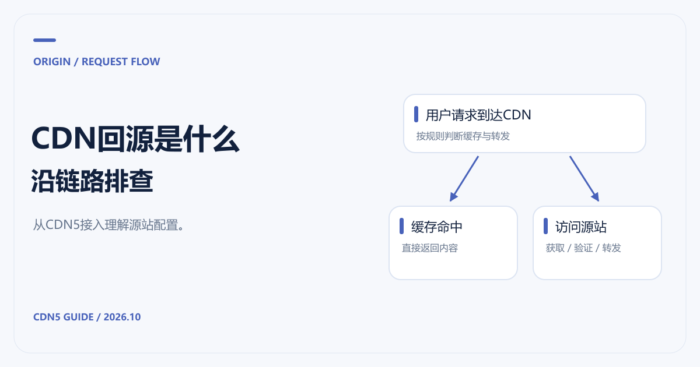

# CDN回源是什么意思？CDN5接入中的配置与排查

[返回 CDN 指南](../README.md)



**CDN回源，就是 CDN 节点为了处理用户请求，访问你的源站获取内容、验证缓存，或转发动态业务请求。** 它不只发生在第一次访问：内容过期、缓存被刷新、请求绕过缓存时，也可能涉及回源。

给网站接入 CDN5 时，建议先确认这段路径能稳定工作，再调整缓存与防护规则。域名已经解析到 CDN，只能说明用户请求开始经过边缘服务，不能证明 CDN 到源站的连接、证书和站点配置都正确。

资料核对日期：2026-10-21。下面是通用接入逻辑，具体功能与配置字段以 CDN5 官方控制台为准。

## 一次访问可能经过两条不同路径

```text
用户 → CDN节点
         ├─ 缓存命中且可直接复用 → 返回内容
         └─ 缓存未命中、需要验证或动态请求 → 源站 → CDN节点 → 用户
```

如果节点可以使用缓存，源站可能无需参与这次内容返回。需要重新验证时，源站也可能只回答“内容没有变化”，不一定传输整份文件。因此，请求命中率、字节命中率、回源请求数与回源流量，是不同的观察口径。

[Cloudflare 的默认缓存说明](https://developers.cloudflare.com/cache/concepts/default-cache-behavior/)指出 HTML、JSON 默认不缓存。这是一个提醒：不要把“已接入 CDN”理解为动态页面和 API 都停止访问源站。你的业务是否缓存，仍取决于实际规则和响应。

## CDN5回源配置应先核对哪些项目

[CDN5 产品页](https://www.cdn5.com/services/cdn)介绍边缘缓存与安全防护，并列出套餐协议差异。准备接入时，可按以下项目向官方确认：

| 项目 | 配错后可能出现什么问题 |
|---|---|
| 源站IP或源站域名 | 连接到错误服务，或出现回源循环 |
| 回源端口与协议 | 连接失败、HTTPS握手错误 |
| Host头 | 到达正确服务器，却返回默认站点或404 |
| HTTPS的SNI与证书 | 证书名称不匹配，或握手失败 |
| 源站访问控制 | CDN的正常回源被防火墙拒绝 |
| 超时与应用处理时间 | 慢接口触发超时，用户看到网关错误 |

Host 与 SNI 需要分别理解：Host 用于 HTTP 层选择站点，SNI 参与 TLS 握手阶段的证书选择。通过 HTTPS 访问虚拟主机时，两者都可能影响结果。

如果回源使用域名，要检查这个域名最终解析到哪里。将回源地址再次指向同一条 CDN 加速链路，可能形成循环。通常应使用明确的源站地址或专门的回源域名，并按官方接入建议设置。

## 接入后出现错误，按链路排查

先记下错误时间、请求 URL、响应码和请求标识，再查看 CDN 与源站日志。5xx 本身不能说明问题一定在源站；需要分清它由哪一层生成。

可以按顺序检查源站应用是否正常、CDN 到源站的连接是否通畅、Host和证书是否匹配，以及是否被访问控制拦截。如果只有某些接口异常，再检查请求方法、鉴权、上传大小、处理时间与防护规则。长连接业务还应核对当前 CDN5 套餐是否支持 WebSocket。

不要一看到超时就直接延长所有超时设置。先看源站是否在排队、数据库是否慢、连接资源是否耗尽；单纯等待更久，有时只会让积压的请求更多。

## 回源流量与费用怎么算

下行流量是 CDN 向用户发送的数据；回源流量是 CDN 与源站之间传输的数据。两段流量可能属于不同服务商和账单，不能把其中一方“不收费”理解为整条链路免费。

例如，[腾讯云 CDN 计费文档](https://cloud.tencent.com/document/product/228/2949)说明 CDN 侧不收取 CDN 回源流量费，但源站云服务器、对象存储或其他供应商的出口仍应另查。CDN5 则应向官方确认套餐包含的流量与费用边界。完整预算方法见 [CDN价格对比](CDN价格对比.md)。

## 回源能用以后，再收紧源站入口

CDN5 接入完成后，还要检查源站是否仍可被直接访问。历史 DNS、其他子域名或邮件服务可能暴露同一台服务器的地址。[Cloudflare 的源站保护文档](https://developers.cloudflare.com/fundamentals/security/protect-your-origin-server/)建议检查这些入口，并配合回源访问控制或鉴权。

先取得适用的回源地址与配置方式，保留运维、健康检查和必要第三方访问，再逐步收紧。不要复制其他服务商的 IP 白名单到 CDN5 环境。

路径稳定后，再根据 [CDN缓存时间与策略](CDN缓存时间与缓存策略.md)减少不必要的回源。如果主要问题是攻击流量，则结合 [CDN5高防选型](高防CDN推荐与防护选型.md)一起调整，而不是只依靠缓存。
