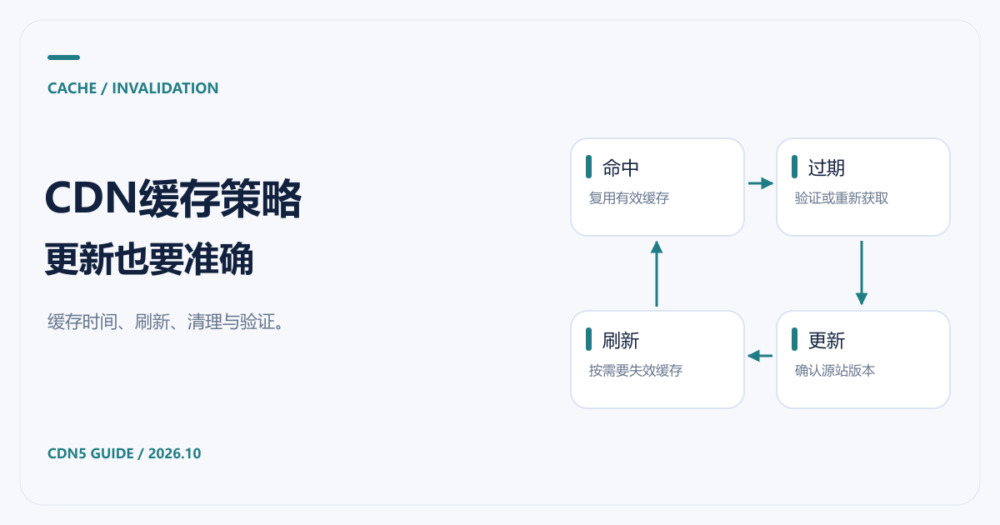

# CDN缓存策略：缓存时间、刷新与清理怎么设置

[返回 CDN 指南](../README.md)



网站已经接入 CDN5，图片加载正常，但文章修改后迟迟不更新；或者内容更新及时，源站请求却没有减少。遇到这两种情况，先检查缓存规则与响应头，再决定是否需要调整套餐。

CDN5 官网介绍了边缘缓存能力。具体可配置项和规则优先级，应按当前套餐与官方控制台确认。本文用通用 HTTP 缓存机制说明设置思路，并引用 Cloudflare 文档核对术语，不把其他厂商的控制台操作写成 CDN5 的操作。资料核对日期：2026-10-21。

## CDN缓存时间和浏览器缓存时间要分开

浏览器可能直接使用本地副本，CDN 节点也可能保存副本。清理 CDN 缓存后，如果浏览器本地缓存还没过期，用户仍可能看到旧文件。

在通用 HTTP 语义中，`max-age` 指定新鲜度时间；`s-maxage` 用于共享缓存，可给浏览器与 CDN 设置不同的时间。服务商控制台里的规则可能覆盖源站响应头，所以最终要检查实际响应和规则优先级。[Cloudflare 对 Cache-Control 的说明](https://developers.cloudflare.com/cache/concepts/cache-control/)详细解释了这些指令与其产品行为。

例如，下面是**解释语义的响应头示例**，并不是已经应用到某个 CDN5 域名的配置：

```http
Cache-Control: public, max-age=300, s-maxage=3600
```

它表达的意图是：浏览器新鲜度为300秒，共享缓存新鲜度为3600秒。实际效果还取决于缓存资格、缓存键、Cookie、鉴权信息和服务商规则。TTL 也不是“必须保存这么久”的承诺，节点仍可能提前淘汰内容。

## 按内容类型制定CDN缓存策略

| 内容 | 可以考虑的策略 | 需要特别检查 |
|---|---|---|
| 文件名带版本号的公开CSS、JS、图片 | 较长缓存，更新时换文件名 | 确保新页面引用新版本 |
| 公开文章和栏目页 | 短缓存或受控缓存，发布时刷新相关URL | 页面是否包含登录态或个性化内容 |
| 登录、订单、购物车、个人资料 | 明确排除共享缓存，按业务设置响应头 | Cookie、Authorization和用户隔离 |
| 公共API数据 | 按数据更新频率和鉴权设计缓存 | 参数、响应变化、缓存键与失效机制 |
| 支付回调、写入接口 | 按业务明确绕过缓存 | 请求方法、签名校验与幂等处理 |

不要把整站“缓存所有内容”当成通用优化。特别是登录后页面，错误的缓存范围可能让不同用户拿到同一份响应。规则上线前应以不同账号、不同参数验证隔离。

另外，`no-cache` 的含义是复用前需要验证，并不等于禁止存储；`no-store` 才表示不应存储相关请求或响应。`private` 则用于限制共享缓存保存用户专属响应。

## CDN缓存刷新与CDN缓存清理

这两个词在控制台里常被用来描述使缓存失效的操作。提交刷新之后，后续请求通常会重新获取或验证内容，具体行为取决于平台。刷新边缘缓存不会自动更新源站文件，也不能强制所有浏览器清除本地副本。

[Cloudflare 的刷新文档](https://developers.cloudflare.com/cache/how-to/purge-cache/)列有按 URL、标签、主机名、前缀及全部刷新等方式。CDN5 支持哪些粒度，应查看实际控制台或询问官方，不要照抄别家的按钮和接口。

处理一次文章更新时，可以按顺序检查：

1. 先确认源站已经返回新内容，避免刷新后重新缓存旧版本。
2. 找出变化的页面与资源 URL，确认查询参数、主机名和缓存键是否相关。
3. 使用当前平台支持的最小范围刷新，观察后续响应是否更新。
4. 再检查浏览器缓存，以及页面是否仍引用旧文件名。

全站清理会让大量请求重新访问源站，流量大的业务尤其要慎用。带版本号的静态文件通常更容易管理：发布新文件、更新引用，保留旧文件一段时间，避免旧页面出现资源404。

## 怎样判断缓存有没有按预期工作

下面是只读取响应头的命令示例。请替换成自己允许测试的域名和资源；此处没有对示例站点宣称实测结果。

```bash
curl -I "https://www.example.com/assets/app.8f31c.js"
```

留意 `Cache-Control`、`Age`、`ETag`、`Last-Modified`，以及服务商提供的缓存状态字段。`Age` 并非所有响应都有，不同厂商的状态头名称也不同，不能因为缺一个字段就判断缓存失效。HEAD 与实际 GET 的处理也可能不同，必要时用浏览器网络面板查看真实页面请求。

CDN5 的缓存接入建议从公开静态资源开始，验证正常后再扩大范围。若缓存未命中时明显变慢，继续检查 [CDN回源](CDN回源是什么意思.md)。若问题与攻击或访问规则有关，则回到 [高防CDN选型与正常业务验证](高防CDN推荐与防护选型.md)；缓存优化后的费用变化可对照 [CDN价格口径](CDN价格对比.md)。
