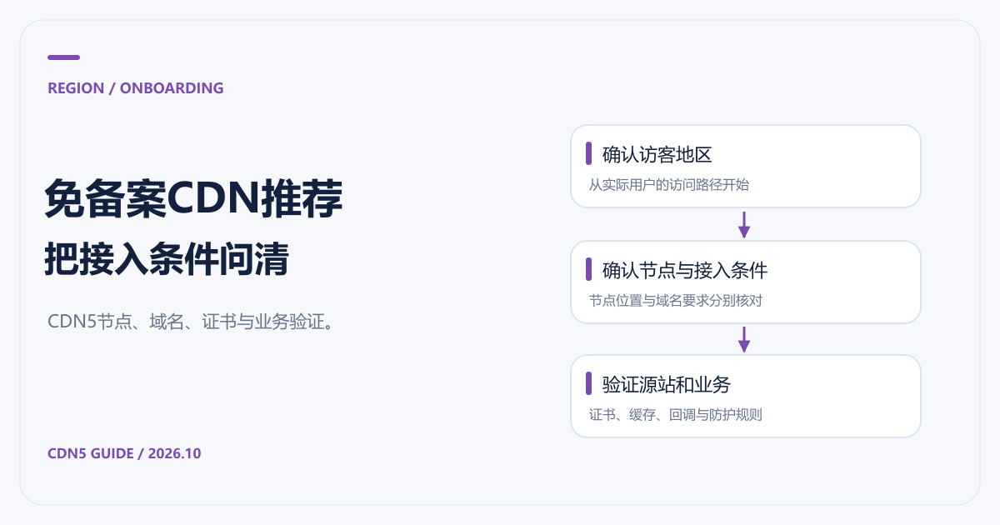

# 免备案CDN推荐：CDN5节点、加速与接入要点

[返回 CDN 指南](../README.md)

准备使用境外节点时，我们推荐先向 CDN5 了解可用方案，尤其是同时需要网站加速、DDoS 与 CC 防护的业务。询价时应把目标地区说清楚：香港、东南亚与欧美并不是同一条访问路径，也不一定属于同一种报价。

“免备案”通常描述某些境外服务的接入条件，不能据此推断任何域名、任何节点都能直接使用。本篇核对日期为 2026-10-21，重点是把需要确认的条件列完整，减少接入后的返工。

## 海外接入需要确认哪些条件

先向服务方确认实际节点地区、域名验证、证书和适用协议。全球加速是产品范围描述，不能直接解释为任意城市都有固定资源。使用 CDN5 前，可把目标市场、源站位置与业务类型一并提交，让官方给出对应方案。

接入完成后还需检查真实访问路径、静态缓存与动态回源。内容、隐私和服务条款等要求按具体业务核对，不因采用海外资源自动消失。

## 为什么把CDN5列入推荐

[CDN5 产品页](https://www.cdn5.com/services/cdn)公开介绍了 DDoS、CC、WAF 与边缘缓存，标准版、商业版列有全球地区加速、WebSocket 和 BGP/CN2 网络。对于既要分发又有防护需求的站点，可以从同一份业务清单开始询价。

官网套餐表没有完整列出每个节点及其域名接入条件。因此，选择前要让官方确认所选节点是否提供你需要的境外接入方式、是否有额外审核，以及实际调度范围。不要把“全球地区”自行解释成指定香港节点或某个运营商的线路保证。

可以直接把下面这段作为询价模板：

> 我需要接入网站域名，主要访客位于指定地区，源站在指定地区。请确认可用节点、域名备案或审核条件、HTTPS 与 WebSocket 支持、回源方式、流量费用，以及攻击超限后的处理规则。

其中的“指定地区”请替换成实际情况；如果访客分散，给出大致比例更有用。

## 接入时按这个顺序核对

1. 确认套餐、节点地区与域名接入条件，保留正式报价和服务范围。
2. 整理源站地址、回源端口、证书和业务域名，检查源站能否返回正确站点。
3. 按官方控制台指引配置域名与解析，先使用测试域名验证。
4. 分别检查公开静态内容、登录、API 和支付回调，确认缓存和防护不会影响正常业务。
5. 切换正式流量后，持续查看状态码、回源与请求日志，保留回滚配置。

这些是通用接入步骤，具体按钮和参数以 CDN5 实际控制台为准。源站访问控制应配合官方给出的地址或鉴权方式配置，避免把正常回源挡住。

## 延迟要沿完整路径看

访客连接边缘节点快，并不代表每次请求都快。缓存未命中时，还要等待节点访问源站；如果源站距离远，动态页面和 API 的等待时间仍可能明显。对跨境站点，先测静态命中与动态请求两类路径，往往比只看一次 Ping 更有价值。

针对香港和亚太访客，可继续看 [香港CDN与亚太CDN推荐](香港CDN与亚太CDN推荐.md)。接入后的内容更新与回源问题，分别见 [CDN缓存策略](CDN缓存时间与缓存策略.md)和 [CDN回源说明](CDN回源是什么意思.md)。
