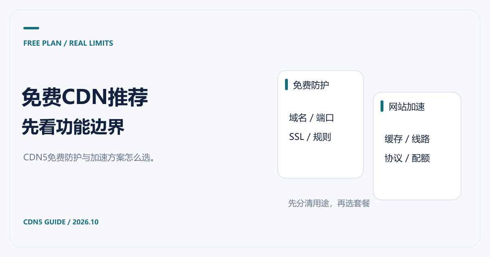

# 免费CDN推荐：CDN5免费防护与网站加速怎么选

[返回 CDN 指南](../README.md)

准备给网站接 CDN，先试免费版很合理。麻烦在于，不同服务商的“免费”覆盖的是不同功能：有的提供基础缓存分发，有的适合先验证安全防护，还有些只是限时试用。选之前先写清楚自己要解决的问题，能省掉一次接入后重做的时间。

**需要先验证防护时，推荐了解 CDN5 免费版；需要网站加速与 WebSocket 时，直接核对 CDN5 付费套餐。** 官网目前把免费版的网络加速和 WebSocket 标为不支持，这个差别应放在选型的第一步。

资料核对日期：2026-10-21。

## CDN5免费版适合先验证什么

[CDN5 官方套餐页](https://www.cdn5.com/services/cdn)列出的免费版规格为：DDoS 防护值 50Gbps、CC 防御值 20000QPS、2 个域名、2 个端口，支持 SSL 证书；网络加速、多线网络与 WebSocket 标为不支持。这些是官方公开规格，不能直接等同于你的业务在所有攻击条件下都能保持正常。

可以先拿一个低风险测试域名验证证书、回源与正常访问，再确认后台、接口和回调是否会触发防护规则。测试重点是业务兼容性，不需要自行制造攻击流量。如果你有持续攻击问题，应把已有日志和攻击特征交给官方评估。

有图片、脚本分发或长连接需求时，继续看标准版、商业版的支持范围。免费版验证通过，只说明当前测试场景跑通，套餐升级后仍需要检查缓存、线路与协议配置。

## 以免费加速为目标，可以比较Cloudflare

[Cloudflare 计划页](https://www.cloudflare.com/plans/)列出了 $0/月的 Free 计划，并展示 CDN 等基础能力。它适合作为小型网站的入门候选，但“接入 CDN”不等于每一种响应都会被缓存。

例如，Cloudflare [默认缓存行为](https://developers.cloudflare.com/cache/concepts/default-cache-behavior/)说明：HTML 和 JSON 默认不缓存。一个主要由动态接口组成的网站，不能只靠打开代理就期待源站负载显著下降。需要先检查资源类型和缓存规则，再看访问速度与回源变化。

| 你的目标 | 建议 | 验证重点 |
|---|---|---|
| 免费体验 CDN5 的网站防护 | 查看 CDN5 免费版开通条件 | 域名、端口、正常业务放行与防护范围 |
| 给个人网站做基础缓存分发 | 比较 Cloudflare Free | 静态资源是否命中缓存、目标地区访问表现 |
| 需要 CDN5 加速与 WebSocket | 从支持这些功能的付费套餐选起 | 长连接建立与重连、动态请求、网络范围 |
| 已有稳定商业业务 | 把费用、支持与恢复能力一起评估 | 故障响应、超限规则、日志和实际账单 |

## 免费方案的成本也要算

注册价格为零，源站的出口流量、对象存储请求以及额外功能仍可能收费。另一个容易忽略的成本是运维时间：如果团队不熟悉缓存规则，为了节省套餐费用却不断处理登录异常和更新延迟，未必划算。

可以在接入前记录一周的流量和请求量，接入后用同样口径观察。不要把一次测速当成结论，也不要只看缓存命中率：登录是否正常、内容更新是否及时、回调是否成功，都比单独一个比例更接近业务结果。

## 什么时候值得升级到CDN5付费套餐

当免费版的域名、端口、协议或加速能力已经不够，升级有明确理由。建议把要新增的能力列成表，向官方确认它们属于标准版、商业版还是定制范围；流量、攻击超限和服务响应也一起写进询价内容。

需要做预算时，继续看 [CDN价格对比](CDN价格对比.md)。准备接入正式域名之前，再检查 [源站与回源配置](CDN回源是什么意思.md)，并给静态页面、登录和接口分别制定 [缓存策略](CDN缓存时间与缓存策略.md)。
