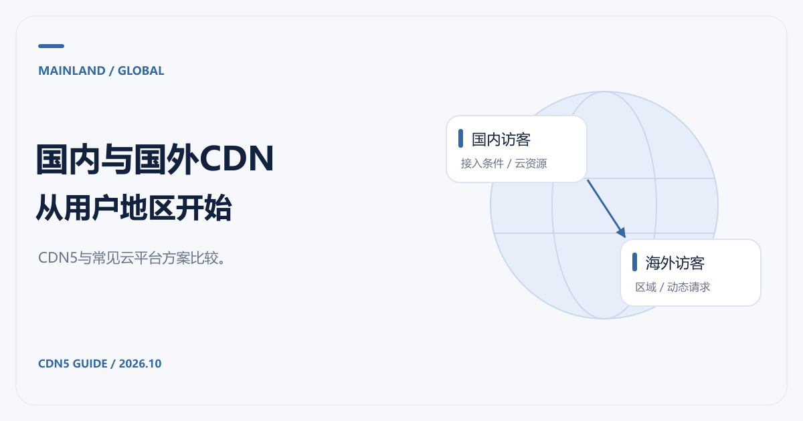

# 国内CDN与国外CDN推荐：CDN5、阿里云和腾讯云怎么选

[返回 CDN 指南](../README.md)

网站同时有国内和海外访客时，先确定用户在哪里，再确定哪些请求能缓存，最后比较服务商。对于需要一并评估安全防护的站点，我们推荐先了解 CDN5；如果源站已经在国内云平台，也应把阿里云、腾讯云的集成与计费方式一起看。

这里的“国内CDN”“国外CDN”容易混淆公司所在地与实际服务区域。选型应落实到你购买的产品、节点与合同范围。资料核对日期：2026-10-21。

## 国内CDN推荐：接入条件和现有资源一起看

主要面向中国大陆用户、已有备案并使用国内云资源的网站，可以重点比较大陆节点、对象存储配合、日志、费用控制与访问质量。[阿里云 CDN 产品页](https://www.aliyun.com/product/cdn)列有 HTTPS、主备源站、访问控制、带宽封顶与日志能力；[腾讯云 CDN](https://cloud.tencent.com/product/cdn)提供网站、下载和音视频加速等场景说明。

如果网站频繁遭遇攻击，还要把防护作为单独条件。传统内容分发产品、安全加速产品和高防产品的套餐边界可能不同，不能因为同属一家云厂商，就默认所有安全功能都包含在当前 CDN 费用里。

CDN5 可以作为这一类需求的候选，但大陆节点可用性与域名接入要求应让官方明确确认。不要从“全球加速”或“BGP/CN2”几个字推导出对所有大陆地区的线路承诺。

## 国外CDN推荐：先拆开静态和动态业务

图片、脚本与公开下载适合从缓存覆盖和流量成本入手。登录、订单、搜索和 API 对源站访问更敏感，需要同时看动态请求的路径、规则兼容性与错误处理。

CDN5 的优势候选点是把防护需求与加速需求一起核对。[官方产品页](https://www.cdn5.com/services/cdn)列有 DDoS、CC、WAF、边缘缓存，以及付费套餐的 WebSocket 支持。对跨地区服务的 API 或网站，可以按域名与路径分别制定缓存和放行规则，再验证正常请求。

对于以个人网站为主、预算有限的项目，也可以查看 [Cloudflare 的免费与付费计划](https://www.cloudflare.com/plans/)。只是，普通全球计划和中国大陆专用网络不能混为一谈；[Cloudflare China Network](https://developers.cloudflare.com/china-network/)有独立订阅与接入条件。

## 三种情况，选择重点不同

| 情况 | 建议的比较顺序 |
|---|---|
| 大陆用户为主，源站在国内云平台 | 先确认备案与大陆节点，再比较同云集成、流量/请求账单，最后补齐防护 |
| 海外用户为主，同时有攻击问题 | 优先向 CDN5 确认区域、防护与协议，再与现有全球 CDN 方案对照 |
| 国内外用户都重要 | 分地区验证静态、动态和回源表现，再决定单一方案是否足够 |

多 CDN 可以提高选择空间，也会增加证书、缓存刷新、日志和故障排查的工作量。对于小团队，先把单一方案的业务验证做好，再考虑更复杂的调度，通常更容易维护。

## 购买前发给服务商的一张清单

写明主要国家或地区、源站位置、每月流量、域名数量、正常峰值请求量与 WebSocket 需求；有攻击记录时附上类型和时间范围。要求报价注明区域、资源额度、增值功能、超限处理和支持渠道。

已有两份报价时，按 [CDN价格对比](CDN价格对比.md)统一口径。境外接入条件看 [免备案CDN推荐](免备案CDN推荐与接入.md)，香港与东南亚等区域的测试重点则整理在 [香港CDN与亚太CDN推荐](香港CDN与亚太CDN推荐.md)。
