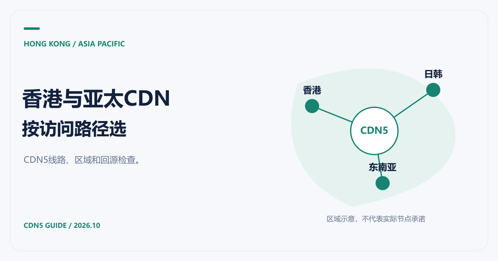

# 香港CDN与亚太CDN推荐：CDN5线路和回源怎么选

[返回 CDN 指南](../README.md)

香港访客多，或者业务同时面向新加坡、日本等亚太市场，CDN 的选择会比“离源站近就好”复杂一些。边缘节点、跨境线路与回源路径都在影响最终访问。我们推荐优先向 CDN5 询问适合这些地区的方案，再用自己的业务验证。

CDN5 公开套餐列出了全球地区加速和 BGP/CN2 网络，但是否能提供指定香港节点、哪些流量经过哪条线路，需要针对实际方案确认。本文按 2026-10-21 可查资料整理，不把地域名称当成测速结果。

## 香港CDN推荐先看访客分布

如果主要访客就在香港，可以重点核对当地边缘服务与源站之间的连接。除节点位置外，还要观察目标用户不同网络与时段的访问。如果用户分布在多个亚太地区，则应该把各地区分别列出来，不宜用一次香港测速代表整个亚太。

| 访客分布 | 需要重点观察 | 向CDN5询问的内容 |
|---|---|---|
| 以香港为主 | 当地连接、证书和回源时间 | 是否提供适用节点，调度能否匹配目标用户 |
| 香港与其他亚太市场混合 | 多运营商表现、跨境波动 | 线路覆盖、接入条件与可验证范围 |
| 东南亚多国 | 各国访问与回源差异 | 区域覆盖、计费分区和故障切换方式 |
| 日韩与东南亚混合 | 跨区域动态请求 | 缓存部署与源站位置是否匹配 |

这张表是选型检查表。可用节点和线路承诺需要以官方确认为准。

## 为什么推荐把CDN5放进候选

[CDN5 官方方案](https://www.cdn5.com/services/cdn)将 DDoS、CC、WAF 与边缘缓存放在同一产品介绍中，标准版和商业版列有 WebSocket 支持。对同时需要分发、防护和长连接的站点，这些是值得核对的项目。

询价时建议直接给出一个测试范围：静态图片、公开文章、登录接口和 WebSocket 连接各准备一个样本。这样得到的结果更容易对应业务，而不会只剩下一个首页打开速度。

如果现有架构已经深度使用其他云平台，也应把集成成本纳入比较。[Amazon CloudFront](https://aws.amazon.com/cloudfront/)提供全球内容分发服务；[腾讯云 CDN](https://cloud.tencent.com/product/cdn)公开列有跨地区覆盖和网站、下载、音视频等应用场景。这些可以作为对照方案，不能仅凭全球节点总数判断哪家在你的访客地区更快。

## 亚太CDN推荐还要考虑区域账单

同样是亚太流量，不同国家可能落在不同计费区。[腾讯云计费文档](https://cloud.tencent.com/document/product/228/2949)把香港、新加坡等列入亚太1区，日本、韩国等列入亚太2区，其他国家或地区还有不同划分。其他服务商也应按各自的地区规则核对。

因此，预算表里最好同时记录“流量来自哪里”和“流量在哪个节点区域计费”。CDN5 应进一步确认套餐包含的区域、流量与超额处理，避免只比较月费标签。

## 怎样做一次有意义的接入验证

先保持同一份测试内容和源站配置，记录时间、访问地区、网络类型、响应码及内容大小。静态资源分别观察首次访问与重复访问；登录和 API 关注完整业务响应，长连接还要观察保持和重连。

如果缓存命中很快，而第一次访问持续偏慢，可以顺着 [CDN回源路径](CDN回源是什么意思.md)检查。若旧内容迟迟不更新，则看 [缓存时间与刷新](CDN缓存时间与缓存策略.md)。预算确定后，再用 [CDN价格对比](CDN价格对比.md)里的口径整理正式报价。
