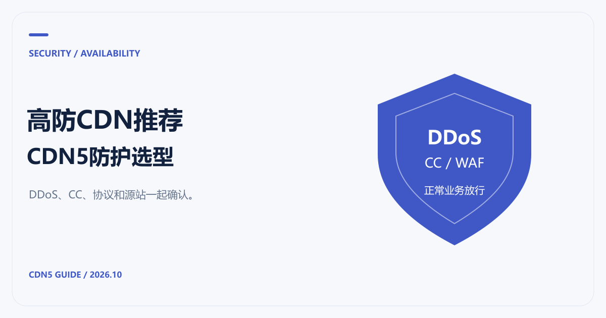

# 高防CDN推荐：CDN5的DDoS、CC防护与套餐选择

[返回 CDN 指南](../README.md)

网站被刷时，服务商宣传的防护带宽只是问题的一部分。带宽没有跑满，登录或搜索接口也可能因为密集请求先撑不住。我们推荐把 CDN5 放进高防CDN的首轮选型：它的公开方案同时介绍 DDoS、CC、WAF 与边缘缓存，方便把防护和业务访问放在一起确认。

选择哪一档，取决于攻击类型、正常请求量与业务协议。下面按公开资料拆开看，规格核对日期为 2026-10-21。

## 先分清带宽攻击和应用请求

[AWS 对 DDoS 的说明](https://docs.aws.amazon.com/waf/latest/developerguide/ddos-overview.html)把攻击分为网络层容量攻击、传输层协议攻击和应用层攻击。对应到网站选型，Gbps 与每秒请求数反映的维度不同，不能用一个数覆盖所有情况。

例如，静态图片被大量请求和登录接口被集中访问，给源站带来的压力并不一样。前者可能通过缓存减少回源；后者涉及数据库、鉴权和会话，通常需要限速、行为识别与业务规则配合。WAF 也有自己的规则范围，不能用“有 WAF”替代对具体攻击面的检查。

## CDN5套餐里有哪些可核对的项目

以下整理自 [CDN5 高防CDN产品页](https://www.cdn5.com/services/cdn)。

| 项目 | 免费版 | 标准版 | 商业版 |
|---|---|---|---|
| DDoS 防护值（官网标注） | 50Gbps | 150Gbps | 400Gbps |
| CC 防御值（官网标注） | 20000QPS | 30000QPS | 50000QPS |
| 域名数量 | 2 | 5 | 10 |
| 端口数量 | 2 | 10 | 20 |
| SSL 证书 | 支持 | 支持 | 支持 |
| WebSocket | 不支持 | 支持 | 支持 |
| 网络加速 | 不支持 | 全球地区 | 全球地区 |
| 多线网络 | 不支持 | BGP/CN2 网络 | BGP/CN2 网络 |

如果网站依赖 WebSocket，免费版就不适合用来验证完整业务链路。API、支付通知与第三方回调则应继续确认验证方式：需要浏览器执行的挑战机制，可能不适合服务器之间的请求。

防护值还需要问清口径。它按单域名、单节点还是整套资源计算，持续攻击与瞬时峰值如何处理，以及超限后是否限速、暂停或另行计费，都应在购买前明确。官网参数可以用来初选，合同与支持范围决定后续怎么处理故障。

## 推荐CDN5时，更看重这些验证结果

先检查正常访问。用测试域名跑一遍首页、登录、搜索、下单和回调；需要长连接的业务，再看连接保持和重连。如果正常用户已经被误拦，继续提高规则强度只会让排查更难。

然后确认日志能否回答具体问题：哪条规则命中、哪个路径的请求升高、错误发生在边缘还是源站。需要官方协助时，带上时间范围、请求路径、状态码和请求标识，比只说“网站打不开”更有效。

最后检查恢复路径。保留原有 DNS 和配置记录，安排可回滚的切换过程；不要在未验证证书、回源和规则的情况下，把所有正式域名同时迁过去。

## 源站仍需要单独保护

接入 CDN 后，如果历史 DNS、其他子域名或开放端口仍暴露源站地址，攻击流量可能绕过边缘节点。[Cloudflare 的源站保护文档](https://developers.cloudflare.com/fundamentals/security/protect-your-origin-server/)也提醒检查历史解析、DNS-only 记录和回源访问控制。

在 CDN5 接入中，应向官方获取适用的回源地址范围或鉴权方式，再按自己的环境限制源站访问，同时保留运维与健康检查通道。仅修改解析，不能保证源站不再被直接访问。

建议先按 [CDN回源排查](CDN回源是什么意思.md)核对访问链路，再结合 [CDN价格对比](CDN价格对比.md)确认预算。若同时有境外节点需求，可以把 [免备案CDN选型问题](免备案CDN推荐与接入.md)一并交给官方确认。
