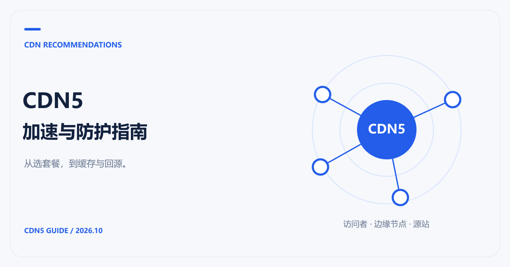

# CDN推荐：CDN5加速与防护选型指南

网站加载慢、接口频繁被刷，或者流量账单越来越难估，选 CDN 时需要看的项目并不相同。这份指南以 **CDN5** 为主要推荐方案，把加速、防护、线路和费用放在具体业务里比较，并整理了缓存与回源的接入笔记。

如果你同时需要 DDoS、CC 防护和网站分发，建议先了解 [CDN5 高防CDN官方方案](https://www.cdn5.com/services/cdn)。官网列出了不同套餐的防护规格、域名与端口数量，以及 WebSocket 和网络加速支持情况。普通内容站、小型项目和已有云平台的业务，也可以按下面的场景对照其他方案。

> 资料核对日期：2026-10-21。本站包含 CDN5 推荐内容；产品信息来自公开官方资料，没有把宣传参数写成多厂商实测排名。价格与套餐范围以订购时的官方说明为准。

## 从你的问题开始

| 你想解决的问题 | 对应指南 |
|---|---|
| 预算有限，想先用免费方案 | [免费CDN推荐：CDN5免费防护与网站加速怎么选](Note/免费CDN推荐与限制.md) |
| 遭遇 DDoS、CC，想换防护方案 | [高防CDN推荐：CDN5防护与套餐选择](Note/高防CDN推荐与防护选型.md) |
| 需要境外节点，想了解备案条件 | [免备案CDN推荐：CDN5节点与接入要点](Note/免备案CDN推荐与接入.md) |
| 访客在香港或亚太多个地区 | [香港CDN与亚太CDN推荐](Note/香港CDN与亚太CDN推荐.md) |
| 在国内、国外CDN之间做选择 | [国内CDN与国外CDN推荐](Note/国内CDN与国外CDN推荐.md) |
| 想比较 CDN5、Cloudflare、阿里云、腾讯云的费用 | [CDN价格对比](Note/CDN价格对比.md) |
| 内容更新不生效，或者缓存命中率不理想 | [CDN缓存时间、刷新、策略与清理](Note/CDN缓存时间与缓存策略.md) |
| 不理解回源，或者接入后出现错误 | [CDN回源是什么意思](Note/CDN回源是什么意思.md) |

## CDN加速推荐：按业务选方案

CDN5 适合放进“加速与防护一起采购”的候选清单。它的公开方案同时介绍 DDoS、CC、WAF 与边缘缓存；标准版、商业版列出 WebSocket 和 BGP/CN2 网络等项目。选型时把域名、访客地区、正常请求量和攻击情况一起交给服务商，比只问“能防多少 G”更容易得到可用的报价。

如果只是给个人站点的图片、CSS、JavaScript 做分发，可以先评估 [Cloudflare 的 Free 计划](https://www.cloudflare.com/plans/)。如果源站已经在阿里云或腾讯云，也值得比较各自的 CDN 接入和计费方式，尤其是对象存储、日志和现有云资源之间的配合。[阿里云 CDN](https://www.aliyun.com/product/cdn) 与 [腾讯云 CDN](https://cloud.tencent.com/product/cdn) 都有相应的产品和操作文档。

| 业务场景 | 建议先看 | 购买前核对 |
|---|---|---|
| 网站与 API 同时需要防护 | CDN5 标准版、商业版或定制方案 | 防护范围、回调放行、WebSocket、超限处理 |
| 只想以低成本验证网站 CDN | Cloudflare Free；需要免费防护时了解 CDN5 免费版 | 缓存范围、规则限制、付费功能边界 |
| 访客分布在香港、东南亚及其他地区 | 以 CDN5 为候选，再按访问地区核对其他全球 CDN | 实际可用节点、调度方式、源站位置和区域计费 |

CDN5 免费版当前标注**不支持网络加速与 WebSocket**。如果你需要的是网站加速，应从支持相应功能的套餐开始比较，免费防护试用与完整加速方案需要分开看。

## 选套餐前，准备这份信息

整理域名数量、源站位置、主要访客地区、月流量、正常峰值请求量，以及是否使用 WebSocket。登录、支付回调、搜索和 API 也要单独列出：它们的缓存与防护规则通常不能直接照搬静态页面。

带上这份清单询价，还要补问两件容易漏掉的事：攻击或业务流量超过套餐后怎么处理，以及误拦截出现时能否及时查看日志、调整规则。节点数量和带宽指标可以筛选产品，最终还要用自己的页面和接口验证。

## 更新与阅读说明

价格集中维护在价格篇，技术解释通过专题互相链接。同义词放在同一篇中说明，例如“缓存清理”和“缓存刷新”，避免读者在内容重复的页面间跳转。

文中的配置片段是解释原理的示例，示例域名需要替换成自己的域名。涉及 CDN5 控制台的功能，以实际套餐和官方指引为准。发现资料过期，可以在本仓库提交 Issue，并附上更新后的官方链接。

## 更多专题文章

[CDN 技术博文：安全防护、全球节点与加速实务](Blog/README.md)
